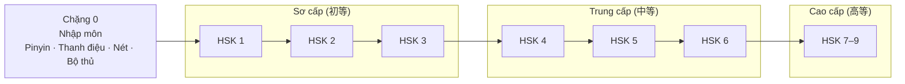

# China Course — Lộ trình học tiếng Trung cho người Việt

Lộ trình tự học tiếng Trung (Phổ thông / 普通话) **từ con số 0 đến cao cấp**, bám theo chuẩn
**HSK 3.0** — *Tiêu chuẩn trình độ tiếng Trung trong giáo dục tiếng Trung quốc tế*
(国际中文教育中文水平等级标准, GF 0025-2021), viết bằng tiếng Việt và tận dụng lợi thế **âm Hán Việt**.

## 🚀 Bắt đầu học ngay

Mở **[`app/index.html`](app/index.html)** bằng trình duyệt (Chrome, Edge hoặc Safari để nghe được giọng đọc tiếng Trung) — không cần cài đặt gì. Cần có mạng để tải thư viện luyện viết.

Hoặc bật **GitHub Pages** (Settings → Pages → Deploy from a branch → `/ (root)`) để học trên điện thoại tại `https://<tên-tài-khoản>.github.io/china-course/`.

Ứng dụng gồm:
- **Lộ trình & bài học từng bước**: hội thoại → từ vựng → ngữ pháp → luyện tập (chọn đáp án, sắp xếp câu, nghe chọn nghĩa)
- **Nghe phát âm** từng câu, từng từ (giọng đọc của trình duyệt)
- **Ôn từ vựng** bằng thẻ ghi nhớ ngắt quãng, tự thêm từ sau mỗi bài
- **Bảng pinyin** tương tác và **luyện viết chữ Hán** bằng chuột/cảm ứng
- Lưu tiến độ trong trình duyệt, có xuất/nhập để sao lưu

Nội dung hiện có: **Chặng 0 — Nhập môn** (4 bài) và **HSK 1 — Unit 1–3** (5 bài). Các bài còn lại đang được biên soạn — xem [ROADMAP.md](ROADMAP.md) và cách thêm bài trong [app/content/README.md](app/content/README.md).

## Bản đồ lộ trình



| Chặng | Thư mục | Chữ Hán (cộng dồn) | Từ vựng (cộng dồn) | Thời gian gợi ý* |
|---|---|---:|---:|---|
| 0. Nhập môn | [`lessons/00-nhap-mon`](lessons/00-nhap-mon) | — | — | 2–3 tuần |
| 1. HSK 1 | [`lessons/01-hsk1`](lessons/01-hsk1) | 300 | 500 | 1,5–2 tháng |
| 2. HSK 2 | [`lessons/02-hsk2`](lessons/02-hsk2) | 600 | 1.272 | 2 tháng |
| 3. HSK 3 | [`lessons/03-hsk3`](lessons/03-hsk3) | 900 | 2.245 | 3 tháng |
| 4. HSK 4 | [`lessons/04-hsk4`](lessons/04-hsk4) | 1.200 | 3.245 | 4–5 tháng |
| 5. HSK 5 | [`lessons/05-hsk5`](lessons/05-hsk5) | 1.500 | 4.316 | 5–6 tháng |
| 6. HSK 6 | [`lessons/06-hsk6`](lessons/06-hsk6) | 1.800 | 5.456 | 6–8 tháng |
| 7. HSK 7–9 | [`lessons/07-hsk7-9`](lessons/07-hsk7-9) | 3.000 | 11.092 | 1–2 năm |

\* Ước lượng cho người tự học ~1 giờ/ngày. Số liệu chữ/từ theo chuẩn GF 0025-2021 — sẽ đối chiếu lại với dữ liệu gốc khi nhập vào [`data/`](data).

## Cấu trúc repo

```
china-course/
├── README.md              # Trang này: tổng quan + bản đồ
├── ROADMAP.md             # Chi tiết mục tiêu, nội dung, đầu ra từng chặng
├── lessons/               # Bài học, chia theo chặng → chủ đề (unit) → bài
│   ├── 00-nhap-mon/
│   ├── 01-hsk1/ … 06-hsk6/
│   └── 07-hsk7-9/
├── docs/
│   ├── phuong-phap.md     # Cách học: SRS, Hán Việt, shadowing, input
│   ├── huong-dan-viet.md  # Quy chuẩn soạn bài học
│   ├── luyen-viet-chu-han.md # Luyện viết chữ Hán: nét, thứ tự nét, bộ thủ
│   └── tai-nguyen.md      # Tài nguyên / repo tham khảo
├── index.html             # Chuyển hướng tới app/ (cho GitHub Pages)
├── app/                   # Ứng dụng học: lộ trình, bài học, ôn thẻ, pinyin
│   └── content/           # Nội dung bài học (JS) — xem README trong thư mục
├── data/                  # Dữ liệu từ vựng, chữ Hán, ngữ pháp (CSV/JSON)
├── tools/
│   └── luyen-viet/        # Trang luyện viết chữ Hán bằng chuột/cảm ứng
└── templates/
    ├── bai-hoc.md         # Mẫu chuẩn cho mỗi bài học
    └── giay-o-mi.svg      # Giấy ô 米字格 A4 để in
```

## Cách dùng

0. Mở [ứng dụng học](app/index.html) và bắt đầu từ Chặng 0.
1. Đọc [docs/phuong-phap.md](docs/phuong-phap.md) để nắm cách học và [docs/luyen-viet-chu-han.md](docs/luyen-viet-chu-han.md) để luyện viết chữ.
2. Bắt đầu từ [Chặng 0 — Nhập môn](lessons/00-nhap-mon), học tuần tự từng unit.
3. Luyện viết chữ trên màn hình với [trang luyện viết](tools/luyen-viet) (mở `tools/luyen-viet/index.html` hoặc qua GitHub Pages).
4. Cuối mỗi chặng làm phần **Kiểm tra đầu ra** trước khi sang chặng tiếp theo.

## Đóng góp

Mỗi bài học mới dùng mẫu [templates/bai-hoc.md](templates/bai-hoc.md) và tuân theo
[docs/huong-dan-viet.md](docs/huong-dan-viet.md) (pinyin, Hán Việt, ngữ pháp, bản quyền, checklist).
