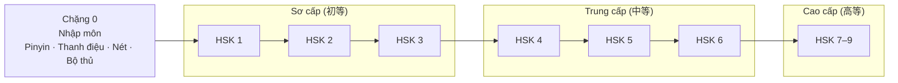

# China Course — Lộ trình học tiếng Trung cho người Việt

Lộ trình tự học tiếng Trung (Phổ thông / 普通话) **từ con số 0 đến cao cấp**, bám theo chuẩn
**HSK 3.0** — *Tiêu chuẩn trình độ tiếng Trung trong giáo dục tiếng Trung quốc tế*
(国际中文教育中文水平等级标准, GF 0025-2021), viết bằng tiếng Việt và tận dụng lợi thế **âm Hán Việt**.

> 🚧 Repo đang ở giai đoạn phác thảo khung. Xem [ROADMAP.md](ROADMAP.md) để biết chi tiết từng chặng.

## Bản đồ lộ trình



| Chặng | Thư mục | Chữ Hán (cộng dồn) | Từ vựng (cộng dồn) | Thời gian gợi ý* |
|---|---|---:|---:|---|
| 0. Nhập môn | [`lessons/00-nhap-mon`](lessons/00-nhap-mon) | — | — | 2–3 tuần |
| 1. HSK 1 | [`lessons/01-hsk1`](lessons/01-hsk1) | 300 | 500 | 1,5–2 tháng |
| 2. HSK 2 | [`lessons/02-hsk2`](lessons/02-hsk2) | 600 | 1.272 | 2 tháng |
| 3. HSK 3 | [`lessons/03-hsk3`](lessons/03-hsk3) | 900 | 2.245 | 3 tháng |
| 4. HSK 4 | [`lessons/04-hsk4`](lessons/04-hsk4) | 1.200 | 3.245 | 4–5 tháng |
| 5. HSK 5 | [`lessons/05-hsk5`](lessons/05-hsk5) | 1.500 | 4.316 | 5–6 tháng |
| 6. HSK 6 | [`lessons/06-hsk6`](lessons/06-hsk6) | 1.800 | 5.456 | 6–8 tháng |
| 7. HSK 7–9 | [`lessons/07-hsk7-9`](lessons/07-hsk7-9) | 3.000 | 11.092 | 1–2 năm |

\* Ước lượng cho người tự học ~1 giờ/ngày. Số liệu chữ/từ theo chuẩn GF 0025-2021 — sẽ đối chiếu lại với dữ liệu gốc khi nhập vào [`data/`](data).

## Cấu trúc repo

```
china-course/
├── README.md              # Trang này: tổng quan + bản đồ
├── ROADMAP.md             # Chi tiết mục tiêu, nội dung, đầu ra từng chặng
├── lessons/               # Bài học, chia theo chặng → chủ đề (unit) → bài
│   ├── 00-nhap-mon/
│   ├── 01-hsk1/ … 06-hsk6/
│   └── 07-hsk7-9/
├── docs/
│   ├── phuong-phap.md     # Cách học: SRS, Hán Việt, shadowing, input
│   ├── huong-dan-viet.md  # Quy chuẩn soạn bài học
│   └── tai-nguyen.md      # Tài nguyên / repo tham khảo
├── data/                  # Dữ liệu từ vựng, chữ Hán, ngữ pháp (CSV/JSON)
└── templates/
    └── bai-hoc.md         # Mẫu chuẩn cho mỗi bài học
```

## Cách dùng

1. Đọc [docs/phuong-phap.md](docs/phuong-phap.md) để nắm cách học.
2. Bắt đầu từ [Chặng 0 — Nhập môn](lessons/00-nhap-mon), học tuần tự từng unit.
3. Cuối mỗi chặng làm phần **Kiểm tra đầu ra** trước khi sang chặng tiếp theo.

## Đóng góp

Mỗi bài học mới dùng mẫu [templates/bai-hoc.md](templates/bai-hoc.md) và tuân theo
[docs/huong-dan-viet.md](docs/huong-dan-viet.md) (pinyin, Hán Việt, ngữ pháp, bản quyền, checklist).
